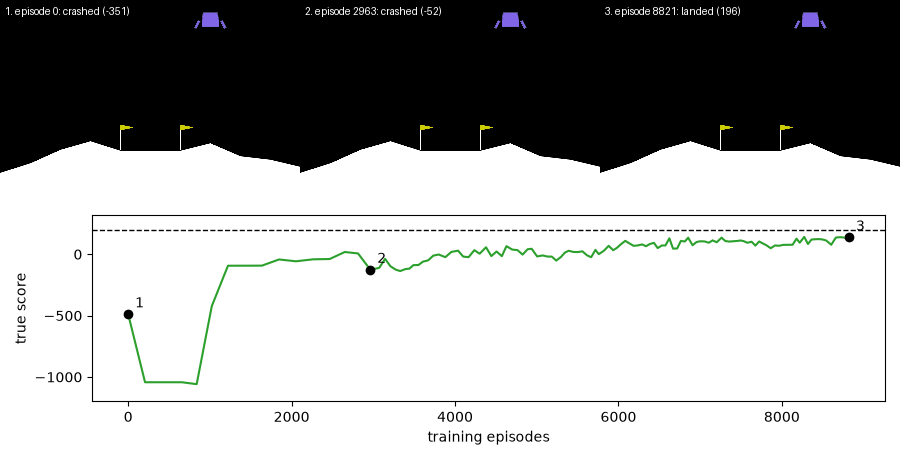
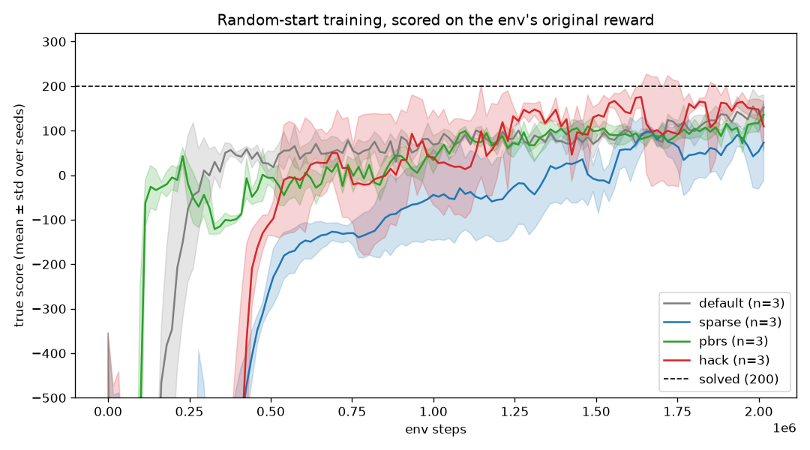
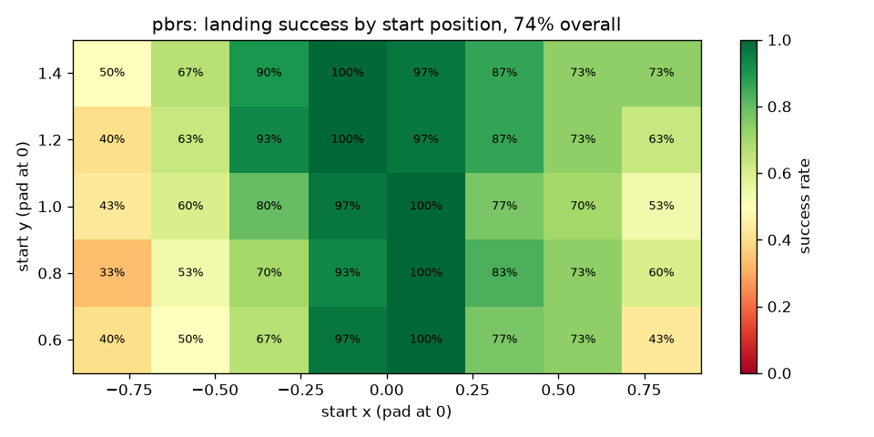
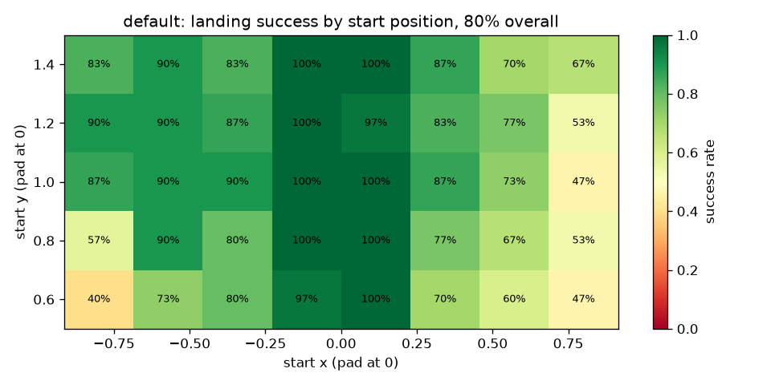
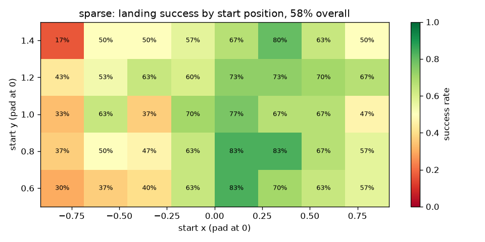
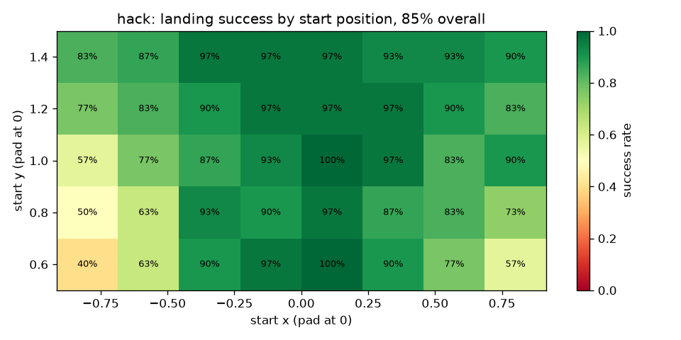

# Rocket Land

Reinforcement-learning agents land Gymnasium's [`LunarLander-v3`](https://github.com/Farama-Foundation/Gymnasium/blob/main/gymnasium/envs/box2d/lunar_lander.py). The project trains the same PPO agent under four reward designs, scores all of them on the same true score, and ships a web app: click a spot in the sky, pick an agent, and watch it land from there.

**Live app:** _link goes here after deploy (Render free web service)._



## Reward shaping in one paragraph

The landing itself is rare and far away: +100 for coming to rest, −100 for crashing. An agent that only sees that signal mostly learns nothing, or learns to fail cheaply. **Reward shaping** adds intermediate signal ("closer, slower, upright is good"). Done naively, it can change what the best behaviour is, and the agent optimises the bonus instead of the goal. **Potential-based shaping** (Ng et al., 1999) adds `F = γΦ(s′) − Φ(s)`. Over an episode those terms telescope to a constant, so the best policy stays the same and only the learning speed changes.

## The four agents

All four use the same PPO settings and are evaluated on the env's original reward (the **true score**) and on landing success (episode ends at rest, +100).

| Agent | Training reward |
|---|---|
| `default` | The env as shipped. Its reward already contains shaping: `Φ_env(s) = −100‖(x,y)‖ − 100‖(vx,vy)‖ − 100|θ| + 10·legL + 10·legR`, step reward `Φ_env(s′) − Φ_env(s)` minus fuel, overridden to ±100 at the end. |
| `sparse` | The env's shaping subtracted back out: only ±100 at the end plus the fuel cost. |
| `pbrs` | `sparse` + my own potential-based shaping, `Φ(s) = −100‖(x,y)‖ − 100‖(vx,vy)‖ − 50|θ| + 10·(legL + legR)`, with γ equal to PPO's γ and `Φ(terminal) = 0`. |
| `hack` | `sparse` + a naive, non-potential bonus: +0.5 for every step within 0.5 of the pad. Hovering near the pad pays more than landing. |

No copy of `lunar_lander.py` is edited; every reward is a wrapper around the installed env ([`shaping.py`](shaping.py)), and [`test_shaping.py`](test_shaping.py) checks the decomposition and the telescoping sum.

## What happened

All numbers live in [`results/summary.md`](results/summary.md), generated from the saved run CSVs by `python plot.py`.

- **Fixed start (seed 0).** `sparse` falls into a trap: firing an engine only costs fuel, so with GAE λ = 0.98 it learns to never fire and crash. `pbrs` with the same λ escapes briefly, then collapses into the same trap. Shortening the GAE horizon to λ = 0.9 fixed it: `pbrs` then reaches a solved score well before `sparse`. `default` prefers 0.98 (the RL-Zoo setting it was tuned with). The project uses 0.9 everywhere and keeps the 0.98 runs as the finding.
- **`hack` hacks.** With the bonus radius at 0.2 it never found the bonus and just hovered high to avoid crashing. At 0.5 it learned to scrape its legs on the pad without coming to rest: a timed-out episode earns more hack reward than a clean landing, at a lower true score.
- **Random starts (3 seeds each).** All agents except `sparse` land from most of the sky. `pbrs` learns useful behaviour first; `default` and `hack` catch up and finish in the same range; `sparse` is slowest and least consistent across seeds. The far left and right edges are the hardest starts, which is why the app's click zone is narrower than the training region.



| | |
|---|---|
|  |  |
|  |  |

## The app

[`app.py`](app.py) runs the real Box2D episode on the server, with each trained policy's weights exported to numpy (`train.py --export`) so serving needs no torch, and sends back a trajectory (position, angle, leg contacts, action, running true score per step). The page draws it as SVG in the browser. Each agent in the app is the best of its three seeds inside the click zone; the "land in zone" figure on each card is read from `results/heatmap_*.csv`.

## Reproduce

Python 3.11 or 3.12 (Box2D wheels are unreliable on 3.13).

```bash
python -m venv .venv && .venv\Scripts\activate      # Linux/macOS: source .venv/bin/activate
pip install -r requirements.txt
python test_shaping.py                               # reward + start-position + app checks
python train.py --reward pbrs --seed 0 --random-start --steps 2000000   # one run, ~15–30 min on a laptop CPU
python plot.py                                       # results/ from runs/*/eval.csv
python app.py                                        # http://localhost:7860
```

Serving only needs `pip install -r requirements-app.txt` (Gymnasium, Gradio, NumPy). After retraining a shipped model, refresh its weights with `python train.py --export models/<reward>.zip`.

`train.py --reward {default,sparse,pbrs,hack} --seed N --steps N [--random-start] [--gae-lambda L]` writes `runs/{reward}_s{seed}[_rand]/eval.csv`, a checkpoint per evaluation, and `model.zip`. The full random-start sweep is 4 rewards × seeds 0–2 × 2M steps.
